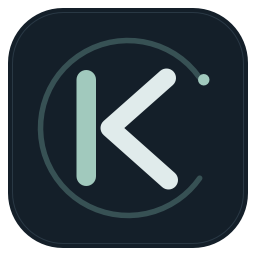

# Kairos Monitor



Monitor nativo para la barra de menús de macOS, escrito en Rust y AppKit. Telemetría de Kairos y detección de modelos en servidores compatibles con OpenAI. **Solo Apple Silicon (M1 o posterior), macOS 12 o posterior.**

## Descargar e instalar

[Descargar KairosMonitor 0.3.0 para Apple Silicon](https://github.com/amartinrojarvis/kairosmonitor/releases/download/v0.3.0/KairosMonitor-0.3.0-arm64.dmg) · [Todas las versiones](https://github.com/amartinrojarvis/kairosmonitor/releases)

1. Abre el DMG y arrastra **KairosMonitor.app** a **Applications / Aplicaciones**.
2. Abre la app. En el primer arranque aparecen los ajustes de conexión.
3. Introduce la URL, pulsa **Probar conexión** y revisa los modelos detectados. No necesitas introducir sus nombres ni identificadores de servicio.
4. Pulsa **Guardar**. Si lo deseas, activa **Abrir al iniciar sesión**; en instalaciones nuevas viene desactivado.

No necesitas Rust, Homebrew ni Terminal. El nuevo Mac debe poder acceder a tu servidor; si utilizas `http://kairos:8787`, necesitará la conexión de red correspondiente, por ejemplo Tailscale, y resolver ese nombre, o utilizar su IP.

La distribución actual tiene firma **ad hoc**, sin Developer ID ni notarización de Apple. Si macOS bloquea la primera apertura, intenta abrir la app y utiliza **Ajustes del Sistema → Privacidad y seguridad → Abrir igualmente**. En macOS 12: Preferencias del Sistema → Seguridad y privacidad → General. [Guía oficial de Apple](https://support.apple.com/es-es/102445).

## Conectar y detectar modelos

| URL de ejemplo | Comportamiento |
| --- | --- |
| `http://kairos:8787` | Detecta `/api/metrics`; si no es compatible, prueba `/v1/models`. |
| `http://kairos:8787/api/metrics` | Consulta directamente la telemetría de Kairos. |
| `http://servidor:8000/v1` | Consulta `/v1/models`. |
| `https://servidor/prefijo/v1/models` | Utiliza exactamente ese endpoint; admite rutas de proxy. |

**Kairos**: descubre los modelos activos, evita duplicados y alias de enrutamiento, y selecciona automáticamente el servicio asociado al rendimiento publicado. El panel muestra GPU, temperatura, potencia, RAM, swap, rendimiento, CPU, carga, red, disco, modelo, contexto, consumidores e historial de tokens/s. Los servicios detenidos no conservan rendimiento antiguo.

**OpenAI compatible**: descubre el catálogo publicado en `/v1/models`. La barra muestra el número de modelos y el panel sus nombres. Ese catálogo no incluye GPU, RAM ni tokens/s: para monitorizar esas métricas, utiliza el endpoint de Kairos. La prueba verifica acceso y formato del catálogo; no envía prompts ni ejecuta inferencias.

**Probar conexión** utiliza la URL y el timeout del formulario sin guardar cambios. Muestra el tipo de servidor y los modelos, o un error concreto. Si editas la URL durante la prueba, se descarta su resultado para ese campo. Las pruebas y el sondeo habitual comparten un trabajador y una sesión de red; no lanzan consultas simultáneas. El endpoint detectado se reutiliza en las siguientes lecturas.

Esta versión no tiene campo para clave API: los endpoints que requieren autorización devuelven un mensaje específico para HTTP 401/403. Consulta [la guía de conexión](docs/CONEXION.md) para diagnóstico y límites.

## Barra y avisos

- Clic izquierdo: abre o cierra el panel. Escape o clic fuera lo cierran.
- Clic derecho: abre el dashboard. Clic central: actualiza la lectura.
- GPU, RAM y tokens/s se pueden mostrar por separado desde Ajustes; debe quedar al menos una métrica visible en el modo Kairos.
- **Ancho fijo y compacto** para las métricas elegidas, cifras alineadas a la derecha y márgenes exteriores de 4 puntos. Cambiar cifras, entrar en aviso o perder la conexión no desplaza los demás widgets. Cambiar las métricas visibles o el tipo de servidor sí cambia el espacio necesario.
- Las cifras grandes se abrevian (`1.2k`, `12M`; memoria en `G`, `T`, `P`, `E`). La barra conserva fondo transparente y resaltado nativo, sin marcos laterales superpuestos.
- **Solo la cifra afectada** cambia de color: ocre suave para aviso y rojo apagado para crítico, adaptados a apariencia clara y oscura. Los iconos, separadores y demás cifras mantienen el color nativo. Al pasar el puntero se explica el motivo.

| Aviso configurable | Aviso inicial | Crítico inicial |
| --- | --- | --- |
| Uso de GPU | 85 % | 95 % |
| Temperatura de GPU | 78 °C | 88 °C |
| RAM ocupada | 85 % | 95 % |

La cifra de GPU avisa por uso o temperatura, tomando el nivel más alto. La RAM se colorea según su porcentaje ocupado aunque la barra muestre GiB. Una tasa alta de tokens/s no se considera un problema. Los umbrales son preferencias de visualización, no límites universales del hardware.

## Consumo y preferencias

- Binario exclusivo `arm64`, optimizado para tamaño, con LTO y símbolos de depuración eliminados.
- Interfaz AppKit: sin navegador, Electron, fuentes empaquetadas ni servidor local.
- Sesión HTTP nativa reutilizable, sin procesos `curl`, caché en disco ni cookies.
- Un trabajador de red, una petición simultánea, timeout por petición y respuesta limitada a 2 MiB, incluso con transferencia fragmentada.
- Temporizador de un solo disparo, con tolerancia para agrupar despertares; sin sondeo periódico de la interfaz.
- La imagen de la barra se regenera cuando cambia su contenido, estado de alerta o configuración; el panel cerrado no se redibuja.
- Historial acotado: 44 lecturas por defecto, configurable de 8 a 600. Los errores borran la lectura actual y dejan huecos en el historial.

La frecuencia predeterminada es 5 s con el panel cerrado y 2 s abierto; puedes aumentar los intervalos para consultar menos. El consumo real depende del servidor, del intervalo y de si el panel está abierto.

**Ajustes** permite modificar conexión, intervalos, timeout, historial, umbrales, gráfico, métricas visibles e inicio de sesión. Los cambios se aplican al guardar sin reiniciar. Las configuraciones anteriores se conservan: `service` se acepta por compatibilidad, pero el servicio se detecta automáticamente. Los antiguos campos `border`, `fillAlpha`, `borderAlpha` y `valueChars` no controlan el dibujo ni el ancho actual.

Configuración: `~/Library/Application Support/KairosMonitor/config.toml`. Editarla a mano requiere reiniciar. El inicio de sesión pertenece a cada Mac y se gestiona mediante `~/Library/LaunchAgents/es.amartin.kairosmonitor.plist`. La app debe estar en `/Applications` o `~/Applications` para activarlo. No utiliza `KeepAlive`: **Salir** mantiene la app cerrada hasta abrirla de nuevo o iniciar otra sesión.

Para actualizar, sal y reemplaza la app en Aplicaciones. Para desinstalar, desactiva el inicio de sesión, guarda, sal y elimina la app. Se conservan tus ajustes.

## Compilar y empaquetar

Requiere herramientas de Xcode, Rust estable y el target `aarch64-apple-darwin`.

```sh
rustup target add aarch64-apple-darwin
./scripts/build-app.sh   # dist/KairosMonitor.app
./scripts/package.sh     # DMG arm64 y SHA256SUMS.txt
./scripts/install.sh     # instala en ~/Applications; conserva ajustes e inicio de sesión
```

La versión del bundle y del DMG se obtiene de `Cargo.toml`. El empaquetado comprueba firma, plist, arquitectura e integridad del DMG. El nuevo icono combina una K y un arco de reloj, dibujados mediante AppKit en `scripts/icon.swift`; se generan sus resoluciones al compilar, sin añadir dependencias al ejecutable. `CODE_SIGN_IDENTITY` permite seleccionar un certificado disponible; la notarización es un paso independiente.

## Comprobaciones

```sh
cargo test
cargo clippy --all-targets -- -D warnings
cargo run -- --check
cargo run -- --open
cargo run -- --snapshot /tmp/kairos.png --fixture tests/fixtures/metrics.json
cargo run -- --snapshot /tmp/kairos-offline.png --offline
cargo run -- --snapshot-bar /tmp/kairos-bar.png --fixture tests/fixtures/metrics.json
cargo run -- --snapshot-bar /tmp/kairos-native.png --fixture tests/fixtures/metrics.json --native --dark --selected
cargo run -- --snapshot-settings /tmp/kairos-settings.png
```

Las pruebas cubren reutilización de conexión, datos frescos sin caché, errores HTTP/JSON, límite de tamaño, timeout, detección de endpoints y modelos, ausencia de telemetría en OpenAI, límites de avisos, abreviaturas, migración de ajustes y rutas de inicio de sesión. Las capturas nativas permiten comprobar el botón real y que la capa de cifras coloreadas no intercepte clics. `--config RUTA` permite usar ajustes alternativos; `--login-item status|on|off` consulta o cambia el inicio de sesión del binario instalado.

`src/network.rs` gestiona la red; `src/model.rs` interpreta datos y avisos; `src/ui.rs` coordina AppKit y consultas; `src/drawing.rs` dibuja barra y panel; `src/config.rs` valida y guarda ajustes; `src/settings.rs` contiene el formulario; `src/login.rs` gestiona el inicio de sesión.

`reference/` conserva el plugin original de X1 (Omarchy/Quickshell). Kairos Monitor consulta el endpoint directamente: X1 no necesita estar encendido. La fuente histórica y su licencia permanecen en el repositorio, pero no se distribuyen dentro de la aplicación.
